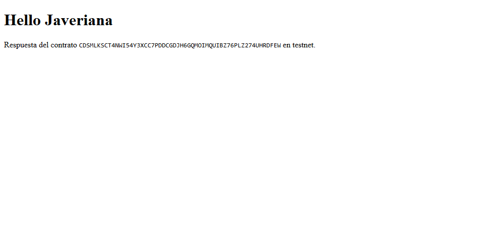

# Getting Started

Evidencia de que el equipo instaló el entorno y desplegó su primer contrato en testnet.
Guía que seguimos: [Getting Started de contratos](https://developers.stellar.org/docs/build/smart-contracts/getting-started).

| Dato | Valor |
|---|---|
| Equipo | Machea |
| Integrantes | Santiago Diaz Sabogal (Técnico), Juan Diego Ortiz Guerrero (Emprendimiento) y Carlos Andrés Figueroa Vega (Emprendimiento) |
| Lo hizo | Santiago Diaz Sabogal (Técnico) |
| Sistema operativo | Windows 11 Home (26H2) |
| Fecha | 2026-10-27 |

## 1. Entorno

Salida de los comandos, copiada de la terminal como texto (no como captura).

```
$ rustc --version
rustc 1.99.1 (58cf8f9c3 2026-10-13)

$ stellar --version
stellar 28.1.0 (c0f4d0da891bbf214c08b8c5035ae6db80e9a3bd)
stellar-xdr 28.0.0 (d0f1330e43c3a2c0c616da30698b24140d4eea72)
xdr (9c9c145953e80990d6ff1ae3a6a973a0ce6d0694)
```

> Nota de Windows: Smart App Control bloqueó el `stellar.exe` del instalador y los scripts de compilación de `stellar contract build` («Una directiva de Control de aplicaciones bloqueó este archivo», os error 4551). Instalé la CLI desde el código fuente con `cargo install --locked stellar-cli`, y el `.wasm` lo compilé con `stellar contract build` (misma versión 28.1.0) en GitHub Actions; luego lo desplegué e invoqué desde mi PC. El workflow está en `.github/workflows/build.yml` del proyecto del contrato.

## 2. Mínimo · paso 2: hello_world en testnet

| Dato | Valor |
|---|---|
| Red | Testnet |
| Cuenta que desplegó | `alice` · `GDMXXGNVCOLW3G3QGW3XJSOG7IKIRMJUNPAJHY5WH4EOMPCDNFZUT7GD` |
| Contract ID | `CDSMLKSCT4NWI54Y3XCC7PDDCGDJH6GQMOIMQUIBZ76PLZ274UHRDFEW` |
| Enlace en stellar.expert | https://stellar.expert/explorer/testnet/contract/CDSMLKSCT4NWI54Y3XCC7PDDCGDJH6GQMOIMQUIBZ76PLZ274UHRDFEW |
| Hash del invoke de `hello` | `7f99e866e7e24e28ece53bc788c64ccdd7e99eecbba9b68b67bed81741c3cdae` |
| Resultado del invoke | `["Hello","Javeriana"]` |

## 3. Reto · paso 5: frontend de Hello World

Opcional. Llénalo si llegaste al paso 5 del Getting Started: los pasos 3 y 4 despliegan el contrato `increment` y el paso 5 conecta un frontend al contrato.

| Dato | Valor |
|---|---|
| Contract ID de `increment` | `CDJT5O366E5CPBW7POE34Z3RNAIGF2BMLX76EVTFYXJ2CWIWPJ5PXQYT` |
| Enlace en stellar.expert | https://stellar.expert/explorer/testnet/contract/CDJT5O366E5CPBW7POE34Z3RNAIGF2BMLX76EVTFYXJ2CWIWPJ5PXQYT |
| Comando con el que corre el frontend | `npm run dev` (Astro, http://localhost:4321) |

El frontend llama a `hello` del contrato `hello_world` (`CDSMLKSCT4NWI54Y3XCC7PDDCGDJH6GQMOIMQUIBZ76PLZ274UHRDFEW`) con `to: "Javeriana"` y muestra la respuesta:



## 4. Comandos que usamos

```bash
# Crear el proyecto y compilar
stellar contract init hello-jave
cd hello-jave
stellar contract build   # en Windows lo corrí en GitHub Actions (ver nota de la sección 1)
gh run download 40605237181 -n wasm -D target/wasm32v1-none/release

# Cuenta de testnet con fondos de Friendbot
stellar keys generate alice --network testnet --fund

# Desplegar: devuelve el Contract ID (empieza por C)
stellar contract deploy \
  --wasm target/wasm32v1-none/release/hello_world.wasm \
  --source-account alice --network testnet --alias hello_world

# Invocar hello y enviar la transacción para obtener el hash
stellar contract invoke --id hello_world --source-account alice \
  --network testnet --send=yes -- hello --to Javeriana
```

> 💡 **¿Por qué `--send=yes`?** `hello` solo lee, no escribe nada. Sin esa opción la CLI simula la llamada, te muestra el resultado y **no** envía transacción, así que no hay hash que pegar.

Si hiciste el reto, agrega aquí los comandos que usaste en los pasos 3 a 5:

```bash
# Paso 3: contrato increment en el mismo workspace (código de la guía en contracts/increment/src)
stellar contract init . --name increment
stellar contract build   # en GitHub Actions, igual que hello_world
cargo test               # 1 passed por contrato

# Paso 4: desplegar e invocar (devolvió 1 y luego 2)
stellar contract deploy \
  --wasm target/wasm32v1-none/release/increment.wasm \
  --source-account alice --network testnet --alias increment
stellar contract invoke --id increment --source-account alice --network testnet -- increment

# Paso 5: frontend con Astro
npm create astro@latest hello-frontend -- --template minimal
cd hello-frontend
stellar contract bindings typescript --network testnet \
  --contract-id CDSMLKSCT4NWI54Y3XCC7PDDCGDJH6GQMOIMQUIBZ76PLZ274UHRDFEW \
  --output-dir packages/hello_world
cd packages/hello_world && npm install && npm run build && cd ../..
npm install ./packages/hello_world   # para importarlo como 'hello_world' en src/pages/index.astro
npm run dev
```

## 5. Revisión antes del PR

Mínimo:

- [x] Las versiones están pegadas como texto, con el comando arriba de cada una.
- [x] El Contract ID empieza por `C` y el enlace de stellar.expert abre el contrato.
- [x] El hash tiene 64 caracteres y aparece en stellar.expert al buscarlo.
- [x] No hay llaves secretas (`S…`) en ningún archivo.

Reto (opcional):

- [x] El Contract ID de `increment` abre en stellar.expert.
- [x] `frontend.png` está en esta carpeta y se ve en la vista previa de GitHub.
